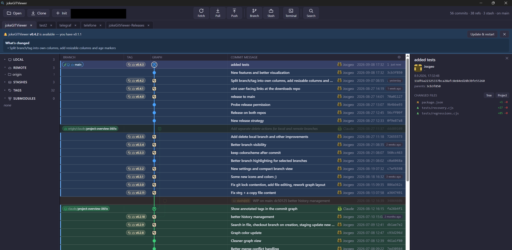
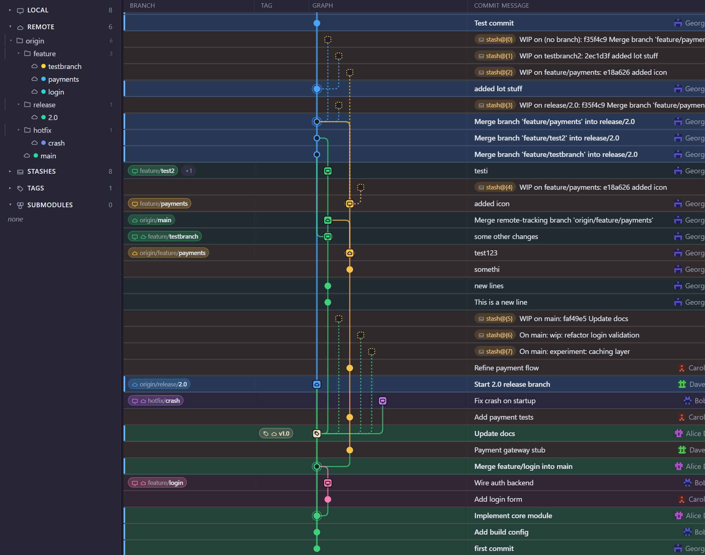

# jokeGITViewer — Downloads

A fast, lightweight Git GUI for **Windows, Linux and macOS** — a slim, open take
on visual Git clients like GitKraken. See your whole history at a glance, manage
branches, stashes and submodules, stage down to the single line, resolve merge
conflicts and cherry-pick interactively — all from one window.

Built with **Tauri 2** (Rust backend + web UI) and the local **`git` CLI** — no
bundled libgit2, no heavy runtime. Small binary, native window.

### ⬇️ [Get the latest version](https://github.com/jocgeo/jokeGitViewer-Releases/releases/latest)

| Platform | File |
|----------|------|
| Windows (installer) | `.msi` or the NSIS `…-setup.exe` |
| Windows (portable) | `…_x64-portable.exe` — no install needed |
| macOS | `.dmg` (universal, Intel + Apple Silicon) |
| Linux | `.deb` or `.AppImage` |

The app checks this repository for updates and installs them itself.

---

---

## What it does

### Commit graph
- Full **commit graph** with colored lanes and clean **orthogonal merge edges**
- Columns for **Branch · Tag · Graph · Commit message**, each resizable and
  hideable; relative **age markers** ("2 weeks ago") along the side
- Per-author **avatars**, **HEAD** ring + badge, **detached HEAD** flagged in red
- **Stashes** as dashed rectangles, **uncommitted changes** as a dashed WIP node
- Click a commit → its **whole branch lineage highlights**, before and after merges
- **Virtualized rendering** — smooth on repos with thousands of commits
- **Auto-refresh**: local changes appear within seconds, remotes are fetched in
  the background so incoming pushes just show up

### Repositories, branches & submodules
- **Multiple repos in tabs** — reorder by drag & drop, session restored on start
- **Submodules** in the sidebar: open one as its own tab, breadcrumbed to its parent
- Local 🖥 / remote ☁ icons, branches sorted by most recent commit
- **Hide branches** from the graph, **search** branches / commits / tags
- **Drag one branch onto another** in the graph → merge or rebase from a menu
- Clone, init, fetch, pull, push, delete local branches and tags

### Diffs, blame & file history
- File diffs with old/new line numbers and **character-level highlighting** of
  what changed inside a line
- **Syntax highlighting** for the common languages in every file view, edit included
- Red/green **minimap** along the edge — click to jump; `Ctrl+F` find-in-file
- **Blame**: who/when per line, click a line to jump to its commit
- **File history** next to the graph, with +/− line counts; select lines and ask
  for the history of just those lines
- Image diffs as before/after previews

### Staging & commits
- Stage / unstage whole files, **hunks**, or **single lines** straight from the diff
- Summary + description, **amend**, commit local — push stays a separate action
- Open a file, **Modify** it in place and save, without leaving the app

### Cherry-picking (commit → file → line)
- Whole commit, **one file** (3-way merge if the file drifted), or **single lines**
- **Interactive line picking**: your working file on the left, the commit's
  version on the right — hover a change to see where it lands, click to apply,
  click again to revert
- Changed lines are **replaced in place**, not duplicated; changes already in
  your file show **purple** and can't be picked twice
- Applied lines can be **dragged** if the automatic placement was wrong

### Merge conflicts
- Built-in **3-pane resolver** (ours / result / theirs), side by side with synced
  scrolling, line numbers and per-side color coding
- **Conflict counter** and jump-to-next, with a side rail showing where they sit
- **Character-level** highlighting of the conflicting parts
- Take ours / theirs per file or per block, or type your own lines into the result
- Works for merge, rebase, cherry-pick and revert; abort or continue from the panel

---

## Requirements

- Windows 10/11, Linux or macOS (WebView2 ships with Windows 11)
- [Git](https://git-scm.com/) on `PATH`

Windows may warn that the publisher is unknown, because the installers are not
code-signed. Choose **More info → Run anyway**.

> ⚠️ Hobby project. Git operations run real `git` commands on your repos —
> review what each action does before using it on important work.

---

This repository only hosts the downloads — it contains no source code.

## License

[MIT](LICENSE) © Georg Jocher

Not affiliated with GitKraken or any other Git client. "Git" is a trademark of
the Software Freedom Conservancy.
